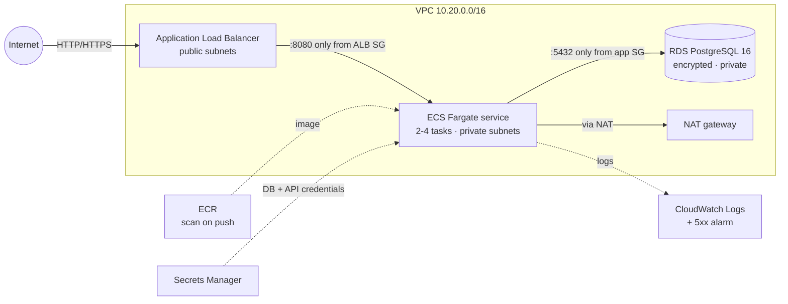

# workhub-aws-terraform

[](https://github.com/alexandra10zam/workhub-aws-terraform/actions/workflows/terraform-ci.yml)


Infrastructure as Code that runs **[WorkHub](https://github.com/alexandra10zam/WorkHub)**, a Spring Boot API, on AWS. It is production-shaped: private networking, managed PostgreSQL, zero-downtime deploys, autoscaling, and no secrets in code or state.

## Architecture



## What this demonstrates

| Area | Implementation |
|---|---|
| **Modules** | Reusable `network`, `database` and `ecs-service` modules composed in `environments/dev`. A `prod` environment is the same modules with different inputs. |
| **Networking** | VPC across 2 AZs, public subnets for the ALB only, private subnets for tasks and DB, NAT (single in dev, per-AZ via `single_nat_gateway = false`), locked-down default SG, VPC flow logs |
| **Least privilege** | Security groups chained by reference (internet → ALB → app → DB). The execution role reads only its own secrets, and the task role has no permissions at all. |
| **Secrets** | RDS generates and stores its own master password (`manage_master_user_password`). The API password is generated by Terraform into Secrets Manager. ECS injects single JSON keys at runtime, so nothing sensitive appears in code or task definitions. |
| **Database** | Encrypted gp3 storage with autoscaling, forced SSL, slow-query logging, automated backups, Performance Insights, Multi-AZ and deletion protection behind variables |
| **Deployments** | Rolling updates at 100%/200%, a **deployment circuit breaker with automatic rollback**, and ALB health checks on Spring Actuator readiness |
| **Scaling** | Target-tracking autoscaling on CPU, with Fargate Spot available as a capacity provider |
| **Containers** | ECR with immutable tags, scan on push and lifecycle rules. Containers run with a read-only root filesystem and only `/tmp` writable. |
| **Observability** | CloudWatch Logs, Container Insights and an alarm on target 5xx |
| **CI** | `terraform fmt` + `validate`, **TFLint** (AWS ruleset) and a **Checkov** security scan on every PR |
| **CD** | Manual `plan`/`apply` workflow authenticated via **GitHub OIDC**, with no AWS access keys stored anywhere |

## Usage

```bash
# 1. One-time: S3 bucket for remote state
aws s3api create-bucket --bucket workhub-tfstate-<account-id> \
  --region eu-central-1 --create-bucket-configuration LocationConstraint=eu-central-1
aws s3api put-bucket-versioning --bucket workhub-tfstate-<account-id> \
  --versioning-configuration Status=Enabled

# 2. Init and create the infrastructure
cd environments/dev
cp backend.hcl.example backend.hcl            # fill in your bucket
cp terraform.tfvars.example terraform.tfvars
terraform init -backend-config=backend.hcl
terraform apply

# 3. Push the WorkHub image to the new ECR repo and roll it out
ECR=$(terraform output -raw ecr_repository_url)
aws ecr get-login-password | docker login --username AWS --password-stdin "${ECR%%/*}"
docker build -t "$ECR:1.0.0" ../../../WorkHub && docker push "$ECR:1.0.0"
terraform apply -var image_tag=1.0.0

# 4. Call the API
curl "$(terraform output -raw app_url)/actuator/health"
aws secretsmanager get-secret-value --secret-id "$(terraform output -raw api_credentials_secret)"

# 5. Tear down when done
terraform destroy
```

## Cost (dev, eu-central-1, approximate)

| Resource | ~USD / month |
|---|---|
| NAT gateway | 35 |
| Application Load Balancer | 20 |
| 2 × Fargate tasks (0.5 vCPU, 1 GB) | 35 |
| RDS db.t4g.micro + 20 GB gp3 | 15 |
| **Total** | **~105**, so run `terraform destroy` after demos |

## Dev vs. production

Security findings that are deliberate dev trade-offs are listed with reasons in [`.checkov.yaml`](.checkov.yaml). For production:

- `multi_az = true`, `deletion_protection = true`, `single_nat_gateway = false`
- set `certificate_arn`: the HTTPS listener and the HTTP→HTTPS redirect are created automatically
- add WAF on the ALB, ALB access logs to S3 and KMS customer-managed keys
- longer log retention

## Layout

```
modules/
├── network/        VPC, subnets, IGW, NAT, routes, flow logs
├── database/       RDS PostgreSQL, subnet group, SG, parameter group
└── ecs-service/    ECR, ECS cluster/service/task, ALB, IAM, autoscaling, alarms
environments/dev/   composition + remote state backend
.github/workflows/  CI (fmt, validate, tflint, checkov) and OIDC deploy
```
